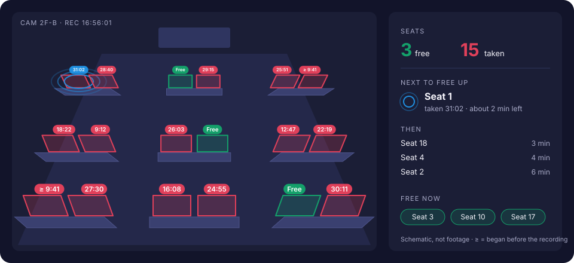
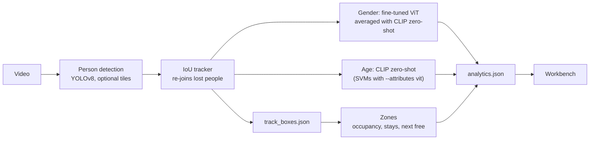

# IFAS: what can one CCTV camera reliably tell you about the people in view?

IFAS (Intelligent Footfall Analysis System) turns fixed-camera footage into
measurements: who is in view (gender, age group), how long they stay, where they
go, and which seats or tables are in use. It started as a product for retail
stores. This repository is now organised as a **research project** around one
question: *which of these measurements hold up on real CCTV, and why?*

Each measurement is treated as a claim to test against held-out data, with
confidence intervals, rather than a number to display. So far the answers are
mixed, and the mixed answers are the findings. The gender model loses about nine
points of accuracy on a PETA subset it was never trained on. The age model is at
chance once its classes are balanced. Footfall counts inflate five-fold in a crowded room.
Zone occupancy, which needs no identity at all, stays consistent with what is
in the frame. What fixed the visible mistakes was not a bigger model but
better votes, stricter tracking, two models averaged, and the system saying
"not sure" when it is.

The system around the research still works end to end: a video goes in, and an
annotated MP4, an `analytics.json` and a browser **workbench** come out.

---

## Research questions

| | Question | Status | Details |
| :- | :--- | :--- | :--- |
| **RQ1** | How large is the gap between the training data (PETA) and real CCTV, and what drives it? | First results on held-out PETA identities; MARS and store footage pending | [research-plan.md](docs/research-plan.md) §2, §8 |
| **RQ2** | Can the gap be closed without labelling store footage (degradation augmentation, Fourier Domain Adaptation)? | Code done, needs a GPU | `src/research/rq2.py`, `research_rq2_training.ipynb` |
| **RQ3** | Does pooling a person's frames help, and should sharp, unoccluded frames count more? | Code done, needs labelled store clips | `src/research/pooling.py`, [paper/sections/rq3.tex](paper/sections/rq3.tex) |
| **RQ4** | Which seats and tables are taken, and which will free up next? | **Runs end to end**; first results on a lecture-room recording, scored against AI-annotator seat labels; human labels pending | [docs/zones.md](docs/zones.md), [paper/sections/rq4.tex](paper/sections/rq4.tex) |

## Findings so far

Every number below is in a results file under `paper/results/`, written by a
script in `scripts/research/`. Intervals are 95%.

1. **The gender model is about nine points worse on images it never trained on.**
   On PETA's CUHK subset, which both released models were trained without, the
   gender ViT scores **0.892 [0.883, 0.901]** accuracy and **0.868** balanced
   accuracy (n = 4,563), against up to **97.8%** validation accuracy reported
   from an image-level split. New people and a new subset both differ from
   that validation set; RQ1's identity split separates the two.
   (`rq1_gap.json`)
2. **The age model is at chance once its classes are balanced.** Plain accuracy
   is **0.757**, but balanced accuracy is **0.238 [0.227, 0.250]** for four
   classes (chance is 0.25), and mean per-group accuracy (mA) is **0.493**,
   against **0.835** reported. Its errors fall as crops get sharper (the
   high-frequency ratio separates right from wrong with AUC 0.596); the gender
   model's do not (AUC 0.496). (`rq1_gap.json`)
3. **The reported numbers came from a split that leaks identities.** In an
   image-level PETA split, 74 to 75% of test images show a person who is also
   in training. Every new result uses identity-disjoint splits
   ([research-data.md](docs/research-data.md)).
4. **A silent loader bug changed results across library versions.** Under some
   `transformers` versions the inference loader skipped the fine-tuned encoder.
   On a 97 s retail clip, the fix changed 15 of 46 people. The version is now
   pinned. (`b1_gender_rebaseline.json`)
5. **In a dense, seated room the detector is the bottleneck.** On 20 frames
   from a lecture room with about forty students, YOLOv8n finds **5.2** people
   per frame at confidence 0.4, and **14.3** with 2×2 tiling. YOLOv8s finds
   21.8 with tiling and YOLOv8m **27.1**, at 2 and 5 seconds per frame on a
   laptop CPU. (`rq4_detection.json`)
6. **Footfall needs identity, and identity breaks in crowds.** The same
   recording produced **231 tracks** for at most **45** people in view, 5.1
   tracks per person. Zone occupancy needs no identity: 41 seats were taken at
   the peak and **37** at the end, in line with the people visible.
   (`rq4_zones.json`)
7. **Seat state is stable once smoothed, and cheap to sample.** Smoothing cuts
   seat-state flicker ten-fold, from 7.10 to **0.71** changes per seat-minute.
   Spatial hysteresis removes 37% of the raw changes without moving occupancy.
   Sampling every 0.8 s instead of 0.2 s keeps **95.9%** of seat states. The
   lower-body anchor puts 6.4% of seated people's sightings in no seat; the box
   centre puts 29.4% there. (`rq4_zones.json`)

8. **On CCTV, averaging two gender models beats either one.** The fine-tuned
   ViT is best on PETA, CLIP zero-shot (no training at all) is best on the
   lecture room, and their average is best on both: **0.888** balanced
   accuracy on PETA's held-out CUHK identities (ViT alone 0.875) and **0.874**
   accuracy on the lecture room (ViT alone 0.820). For age, CLIP zero-shot
   reaches **0.361** balanced on PETA's four groups against the SVMs' 0.238.
   Heads fitted on PETA's training images do *worse* on the lecture room than
   zero-shot. (`attributes.json`, `clip_probe.json`)
9. **"Not sure" beats a wrong answer.** Leaving people below a confidence
   threshold as unknown, gender keeps **82%** of people at **92.7%** accuracy
   and age **72%** at **97.6%** (lecture room). The mistakes you could see in
   the video had concrete causes, each now fixed: all votes taken in a
   person's first five seconds, track numbers drifting between seated
   neighbours, crops showing two people, and boxes drawn with an old label.
   ([research-plan.md](docs/research-plan.md) §10)
10. **Seat occupancy is precise but misses hidden people.** Against seat
    labels on the 20 saved frames, a seat the system calls taken is taken
    **96%** of the time, but 29% of taken seat-moments read free (recall
    **0.71**), mostly students hidden in the back rows. (`rq4_zones.json`)

**About the lecture-room labels.** Findings 8 to 10 use labels made by an AI
annotator (Claude) from the saved frames and crops, clearly marked as such in
the run (`labels_claude-ai.json`, `zone_labels_claude-ai.json`). They are good
for comparing models on the same people, not a substitute for two people
labelling, which the protocol in [research-data.md](docs/research-data.md)
asks for before any of this is reported.

---

## RQ4: zone occupancy, like the restaurant demos



Outline the tables or seats once, or let IFAS find them from where people sat
still. The workbench then shows:
- every place, green when free and red with a running timer when taken
  (≥ when the stay began before the recording);
- a status board, with the place taken longest (the usual guess for the next
  to free up) marked by pulsing rings, its expected time left from a
  Kaplan–Meier curve of stay lengths, and the runners-up;
- a Gantt chart of every stay, utilisation per place, a Kaplan–Meier survival
  curve of stay lengths, and alerts for long stays and long queue waits.

`scripts/render_zones.py` burns the same view into an MP4 with a side panel.

Under the hood:
- an anchor rule for seated people;
- spatial hysteresis, so a leaning person stays in their seat;
- temporal smoothing with censoring at both ends of the recording;
- a causal evaluation of the next-free rule against "taken longest" and chance;
- a zone-labelling page with inter-annotator agreement.

See [docs/zones.md](docs/zones.md).

---

## Reproducing

```bash
pip install -r requirements.txt
python -m pytest -q                      # the whole suite (229 tests), CPU only, a couple of minutes

# Process a recording (models download from the Hugging Face Hub on first use)
python -m src.inference.pipeline --video clip.mp4 --out outputs/runs/clip1 \
    --gender-repo abhshkp/footfall-analysis-vit-stage2 \
    --age-bundle abhshkp/footfall-analysis-age-svm \
    [--tiles 2x2] [--stride 5] [--export-crops] [--site S --camera C]

# RQ1: held-out evaluation (PETA identity split; CUHK for the released models)
python scripts/research/make_peta_split.py --help
python scripts/research/eval_frames.py --domain peta --subsets CUHK --split all --peta-root data/PETA

# RQ4: zone study and detection study on a processed run (no model is re-run for zones)
python scripts/research/zone_study.py --run outputs/runs/clip1
python scripts/research/detector_study.py --video clip.mp4
python scripts/render_zones.py --run outputs/runs/clip1 --video clip.mp4

# Classifiers on labelled people: which model, and how often a final label is right
python scripts/research/attribute_study.py --runs outputs/runs/clip1 --annotator <name>
python scripts/research/label_check.py --run outputs/runs/clip1 --annotator <name>

# Figures and the numbers the paper quotes
python paper/figures/make_figures.py
```

Results land in `paper/results/*.json` as `{"meta": {commit, date, models,
...}, "rows": [...]}`, so every number can be traced to the code that produced
it. RQ2 and RQ3 need a GPU and labelled clips; Section 8 of
[research-plan.md](docs/research-plan.md) says exactly what each step needs.

## The workbench

```bash
python scripts/generate_demo_run.py      # a synthetic run, so it opens without weights or footage
python -m app.server                     # http://127.0.0.1:8000
```

| Tab | What it shows |
| :--- | :--- |
| Overview | Headline numbers, findings with sample sizes and 95% intervals, footfall and occupancy over time |
| Guide | The recording in plain words for the owner: how busy it was, when people came, whether they stopped, where they went, seats, waits, who visited, what to try, and how far to trust each number |
| Zones | The camera frame with seats and tables, status board, next to free up, stays, utilisation, survival curve, alerts, the zone editor, method settings and validity checks |
| Floor | A 3D floor to orbit and replay: heat columns, paths and zones |
| People | Age × gender, dwell and engagement, per-model confidence |
| Trends | Daily, weekly and monthly comparisons across recordings, per observed hour |
| Video | The annotated recording, linked to every chart's playhead |
| Log | Every tracked person, with CSV export |

Two labelling pages feed the research: `label.html` (gender and age per
person, for RQ1 to RQ3) and `zones-label.html` (taken or free per zone per
frame, for RQ4). Each writes one file per annotator, so agreement can be
measured. Everything is vendored (three.js, fonts), so the workbench runs
offline. Light and dark themes. The full reference, including the analytics
schema and the upload dialog, is in [docs/dashboard.md](docs/dashboard.md).

---

## System



**Gender: a fine-tuned ViT averaged with CLIP zero-shot.** The ViT
(`google/vit-base-patch16-224`) is fine-tuned in two stages. Stage 1 trains on
PETA, first as a linear probe (3 epochs, LR 1e-3) and then fully fine-tuned (10
epochs, LR 1e-5, cosine decay, 10% warmup). Stage 2 adapts it to local footage
at a tenth of those learning rates. CLIP ViT-B/32 is asked, with no training,
whether a crop is a CCTV image of a man or of a woman. The ViT is best on
PETA's small crops, CLIP on 1080p CCTV, and their average on both (finding 8),
so the pipeline averages them (`--attributes ensemble`, the default).

**Age: CLIP zero-shot.** Coarse prompts (a young person, an adult, a
middle-aged person, an old person) map onto PETA's four age groups. The
original age model replicates the PETA baseline (Deng et al., 2014): colour and
LBP texture histograms per body region and one SVM per age group, chosen by
grid search on validation mA. It is at chance on held-out identities (finding
2) and stays available with `--attributes vit`.

**Tracking and pooling.** An IoU tracker re-joins people the detector lost for
a few seconds; in crowded rooms (`--tiles`) a box must overlap a person's last
box by IoU 0.5 to continue them, so a seated neighbour cannot take over. A
person's crops are classified through their whole stay (the gap between votes
doubles every four votes, up to 24 votes), crops that show two people are
skipped, and the votes are pooled by majority. Below a confidence of 0.6
(gender) or 0.4 (age), or when the two halves of a stay disagree, the person
is reported as "not sure" (finding 9). RQ3 tests whether quality-weighted
pooling does better.

Training details and hyperparameter studies:
[docs/training.md](docs/training.md) and
[docs/hyperparameter-analysis](docs/hyperparameter-analysis/README.md).
Architecture diagrams: [docs/architecture](docs/architecture/README.md).

### Notebooks

| Notebook | Purpose |
| :--- | :--- |
| `train_stage1.ipynb` | Stage 1 gender training on PETA; pushes the checkpoint to the Hub |
| `train_stage2.ipynb` | Stage 2 fine-tuning on local labelled crops (`data/user/male`, `data/user/female`) |
| `age_classifier_v3.ipynb` | Age features, per-group SVMs, mA evaluation; exports the bundle |
| `research_rq2_training.ipynb` | RQ2: the adaptation conditions, three seeds each, held-out PETA test |
| `test_model.ipynb` | Spot-check a checkpoint on images or a video |

### Models and checkpoints

Checkpoints are too large for git and live on the Hugging Face Hub:

| Model | Hub repo |
| :--- | :--- |
| Gender, stage 1 | `abhshkp/footfall-analysis-vit-stage1` |
| Gender, stage 2 (pipeline default) | `abhshkp/footfall-analysis-vit-stage2` |
| Age SVM bundle (`age_classifier_bundle.pkl`, about 36 MB) | `abhshkp/footfall-analysis-age-svm` |

```bash
hf download abhshkp/footfall-analysis-vit-stage2 --local-dir models/hf/abhshkp__footfall-analysis-vit-stage2
hf download abhshkp/footfall-analysis-age-svm age_classifier_bundle.pkl
```

`transformers` is pinned (finding 4). New checkpoints from RQ2 go to **new**
Hub repos, so the released ones stay comparable.

---

## Data, consent and ethics

- **PETA** (training, RQ1 and RQ2), **MARS** with MARS-Attribute labels (RQ1,
  RQ3) and **RAP** (optional) are research-only datasets. They are never
  committed or redistributed. Sources, licences and label mappings are in
  [docs/research-data.md](docs/research-data.md).
- **Store and classroom footage** is used only with written permission
  ([letter](docs/research-permission.md)). It is recorded in the table in
  `research-data.md`, and `scripts/research/check_data.py` refuses a test clip
  without a permission row. The lecture-room recording behind RQ4's first
  results **does not have its permission row filled in yet**. No number from it
  goes into a submission until it does.
- Footage, frames, crops, renders and labels stay out of git (`outputs/`,
  `data/`, `footage/`, `*.avi`, `*.mp4`).
- Gender is predicted as PETA's binary label, which is a dataset limitation,
  not a claim about anyone. The system does not identify anyone, and it should
  not be used to monitor individuals.

## Repository layout

```
├── src/
│   ├── inference/          # the system
│   │   ├── pipeline.py     # video -> annotated MP4, analytics.json, track_boxes.json (tiled detection)
│   │   ├── tracker.py      # IoU tracker with re-joining
│   │   ├── models.py       # gender ViT and age SVM wrappers
│   │   ├── analytics.py    # tracks -> the analytics document
│   │   ├── trends.py       # findings with intervals; daily/weekly/monthly comparisons
│   │   └── zones.py        # RQ4: zones, anchors, hysteresis, smoothing, survival, automatic seats
│   ├── research/           # experiments: degrade, spectrum, stats, pooling, quality, attention,
│   │                       #   peta, mars, rq2, zone_eval
│   └── training/           # datasets, model, trainer, transforms (incl. FDA)
├── scripts/
│   ├── research/           # one script per experiment, each writing paper/results/*.json
│   ├── render_zones.py     # RQ4 video with the zone overlay and status panel
│   ├── process_folder.py   # many recordings in one command
│   ├── generate_demo_run.py
│   └── benchmark_stages.py
├── app/                    # the workbench: server.py + static/ (vanilla JS, three.js vendored)
├── paper/                  # IEEE-format paper, per-RQ sections, results/, figures/
├── docs/                   # research plan, data and consent, zones, dashboard, training
├── tests/                  # pytest, CPU only
└── *.ipynb                 # training and evaluation notebooks
```

## Paper

[paper/](paper/README.md) holds the IEEE-format paper (`ifas.tex`), the
research sections written so far (`sections/`, built on their own by
`draft_personA.tex` and `draft_rq4.tex`), the results files and the script that
draws every figure. In the text, each result is a macro filled in from the
results files, so no number is typed by hand.

```bibtex
@misc{ifas2026,
  title  = {{IFAS}: Intelligent Footfall Analysis System for Retail Environments},
  author = {{IFAS team}},
  year   = {2026},
  note   = {Research code and workbench}
}
```
