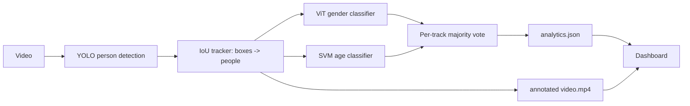

# Dashboard & inference pipeline

The notebooks train and spot-check the models. This part turns them into
something you can look at: a video goes in, an annotated MP4 and an
`analytics.json` come out, and the dashboard reads that JSON.



---

## Quick start

```bash
pip install -r requirements.txt

# 1. Sample run, so you can see the dashboard without any weights
python scripts/generate_demo_run.py

# 2. Serve it
python -m app.server            # http://127.0.0.1:8000
```

No server? The dashboard also works off plain files:

```bash
python -m http.server 8777      # from the repository root
# then open http://127.0.0.1:8777/app/static/index.html
```

In that mode the run picker only offers `demo` and the upload button is inert -
generate runs from the command line instead.

---

## Processing a real video

```bash
python -m src.inference.pipeline \
    --video store_entrance.mp4 \
    --out outputs/runs/store-2026-09-07 \
    --gender-repo abhshkp/footfall-analysis-vit-stage1 \
    --age-bundle models/age \
    --stride 2
```

| Flag | Default | What it does |
| :--- | :--- | :--- |
| `--gender-repo` / `--gender-ckpt` | – | HuggingFace repo id, or a local checkpoint directory |
| `--age-bundle` | – | Directory holding the pickled age SVMs (see below) |
| `--detector` | `yolov8n.pt` | Any Ultralytics weight; `yolov8s.pt` catches more small people |
| `--det-conf` | `0.4` | What it takes to count a new person. Lower it if people are missed, raise it if shelves get boxed |
| `--track-conf` | `0.25` | What a detection needs to pick a lost person back up. It never starts a new person |
| `--rejoin-sec` | `8` | How long a person the detector lost can still be picked up again as the same person. `0` turns it off |
| `--weak-conf` | `0.10` | The weakest detection that is kept. It can extend someone already being followed, or open a *hunch* that needs a second opinion. Set it equal to `--track-conf` to turn hunches off |
| `--verifier` | `yolov8m.pt` | The larger detector asked about hunches. Downloaded once on first use. `none` to do without |
| `--stride` | `2` | Classify every Nth frame. The tracker fills the gaps, so 2-4 is usually free accuracy-wise and halves the runtime |
| `--min-track-frames` | `3` | Tracks shorter than this are discarded as detector noise |
| `--bin-sec` | `5` | Timeline bin width |
| `--max-frames` | – | Stop early; useful for a smoke test |
| `--no-video` | off | Analytics only, no MP4 re-encode |

Either classifier may be omitted - run gender-only or age-only and the
dashboard simply shows fewer filled fields.

### Running the age model

Unlike the gender checkpoint, there is nothing to download - the age SVMs are
not on the Hub. You need a bundle directory; `models/age/` on this machine is
already set up.

**Whether you need `support.npy` depends on which kernel the grid search
picked.** Check first, it saves a lot of work:

```python
import pickle
print(pickle.load(open("classifiers.pkl", "rb"))["configs"])
```

If every attribute says `rbf` (as the current bundle does), the pickle is
self-contained - copy it into `models/age/` and you are finished. Only an
`intersection` entry needs the support matrix, because a precomputed-kernel SVM
can only score against the exact training matrix it was fitted on.

To produce a bundle from scratch:

**1. Run `age_classifier_v3.ipynb`** (Colab, with PETA) through the training
cells, so `classifiers`, `configs` and `X_train` exist.

**2. Export all three artefacts.** The notebook only pickles the classifiers,
which is not enough: a **precomputed-kernel** SVM can only score against the
exact training matrix it was fitted on, so an intersection-kernel bundle needs
the support matrix as well.

```python
import pickle, numpy as np, os
os.makedirs("age_bundle", exist_ok=True)
with open("age_bundle/classifiers.pkl", "wb") as f:
    pickle.dump({"classifiers": classifiers, "configs": configs}, f)
np.save("age_bundle/support.npy", X_train)     # ~40 MB, required for "intersection" configs
```

If the grid search picked RBF for every attribute, `support.npy` is optional -
the loader tells you which case you are in rather than failing obscurely.

**3. Copy the directory next to the repo** (for example `models/age/`) and run:

```bash
pip install scikit-image        # the LBP texture features need it
python -m src.inference.pipeline --video clip.mp4 --out outputs/runs/clip     --gender-repo abhshkp/footfall-analysis-vit-stage1     --age-bundle models/age
```

In the dashboard's **Process video** dialog, put the same path in the *Age
bundle directory* field. Age is optional: without it the pipeline still runs
and the age panels say so instead of showing empty charts.

The feature vector is 550 numbers per crop (5 body regions x (5 colour
histograms x 16 bins + 3 LBP radii x 10 bins)). If your bundle was trained with
different `N_REGIONS`, `COLOR_BINS`, `LBP_POINTS` or `LBP_RADII`, change the
matching constants at the top of `src/inference/models.py` - the SVMs will
otherwise be fed a feature space they were never fitted on.

---

## What a run directory holds

```
outputs/runs/<run-id>/
├── analytics.json    # the whole record - the dashboard reads only this
├── video.mp4         # annotated output (unless --no-video)
└── poster.jpg        # first frame, used as the video poster
```

Drop any such directory under `outputs/runs/` and it appears in the run picker.

---

## The analytics document

`analytics.json` is the raw per-person record plus pre-computed aggregates. The
dashboard re-aggregates the track list itself so that filters change every chart
consistently; the pre-computed blocks are there for anything else that consumes
the file (a notebook, a BI tool, a report).

| Block | Contents |
| :--- | :--- |
| `meta` | source, resolution, fps, duration, frames, device, throughput |
| `config` | detector, thresholds, stride, model ids - everything needed to reproduce |
| `kpis` | visitors, peak/average occupancy, dwell mean/median/total, footfall rate, gender split and ratio, dominant age bucket, mean confidences, low-confidence rate, busiest window |
| `distributions` | gender, age, age×gender, engagement tiers, path types, entry edges, gender/age confidence histograms, dwell histogram, dwell by age / by gender / by segment, per-zone stats |
| `timeline` | per-bin entries, exits, occupancy (mean and peak), gender and age mix |
| `heatmap` | normalised position density grid over the frame |
| `tracks` | one record per person: id, gender + confidence + vote counts, age + confidence + vote counts, first/last second, dwell, tier, frames, detection confidence, mean box area, entry/exit edge, path type, zone, subsampled trail |
| `model` | model families, checkpoint ids, the age model's reported mA |

Two derived fields worth knowing:

* **Engagement tier** - dwell bucketed as Passing (<3s), Glancing (<10s),
  Browsing (<30s), Engaged (<60s), Dwelling (60s+). Time in frame is the only
  interest proxy this pipeline has; it is not attention.
* **Confidence** - gender confidence is the share of summed softmax probability
  the winning label holds across a person's frames; age confidence is a softmax
  over the four one-vs-rest SVM margins. Both are per-person, after voting.

---

## Store insights and period analysis

The **Store insights** section answers business questions rather than model
questions. It has two halves, and the split matters:

**From this recording** - written into `analytics.json` as `insights`, so any
consumer of the file gets them. Footfall rate, the busiest stretch versus the
quietest, stopping power (who stayed 30s+ versus who walked straight past), who
visits, the busiest area of the frame, and which gender x age segment stays
longest. Each line states what was measured in that clip; clips under two
minutes say so instead of being extrapolated to an hourly rate.

**Across all your recordings** - served by `GET /api/trends`, with a period
switch (**Daily / Weekly / Monthly**) and five metrics: visitors per hour, total
visitors, average visit length, share who stayed 30s+, and share women. Each
period also gets a table row carrying hours watched, visitors, rate, dwell,
engagement, gender split and the biggest age group, plus a per-hour-of-day chart
and a gender mix per period.

### The unit is the observed hour, not the clip

Each run pours its arrivals into `(site, camera, date, hour)` buckets that also
record **how many minutes were actually watched**. Every rate is
`arrivals / minutes observed`, which means:

* a three-hour export outweighs a three-minute phone clip, instead of counting
  the same (this was a real bug in the first version - a short clip could swing
  a weekday average by an order of magnitude);
* two clips from the same afternoon merge into one afternoon rather than voting
  twice;
* a clip spanning 16:50-17:10 contributes ten minutes to each of two hours.

Thin data is stated, not drawn: the daily trend needs **3 days** with at least
five minutes of footage each, and the monthly view needs **two different
months**. A day watched for ten seconds is listed but never counted.

### Sites and cameras

Rates from a doorway camera and an aisle camera are not comparable, so runs
carry `site` and `camera` (`--site` / `--camera`, or the fields in the Process
video dialog). When several cameras are pooled, the coverage line says
*"mixing several cameras"*.

### Real footage versus sample data

Generated sample runs are flagged `demo: true` and **excluded from every
aggregate by default**. The coverage line always states the split - "8 samples
excluded", or a highlighted "includes 8 generated samples" when the *Include
samples* box is ticked - and the recordings table labels every row `Footage` or
`Sample`. Nothing generated ever silently enters a number.

### Capture time

Every period is grouped by when the footage was *recorded*, not processed. The
pipeline stores `meta.captured_at`, taken from:

1. `--captured-at "2026-09-05T14:30"` (or the **Recorded on** dialog field), else
2. the video file's own timestamp, which is what camera exports carry, else
3. the time of processing.

### Building history

Periods only mean something once there are many recordings, so adding a day's
footage is one command:

```bash
python scripts/process_folder.py footage/entrance     --site "MG Road" --camera "Entrance"     --gender-repo abhshkp/footfall-analysis-vit-stage1     --age-bundle models/age --no-video
```

It reads the capture time from each filename (`cam1_2026-09-05_17-30-00.mp4`)
or the file's timestamp, skips videos already processed, and keeps going if one
file fails. `--dry-run` shows what it would do; `--no-video` skips the annotated
MP4, which is much faster for bulk history.

---

## Finding your way around

The dashboard is six tabs in a glass bar at the top of the page. On a phone the
tabs move to the bottom of the screen, within reach of a thumb. Keys `1` to `6`
jump between them and the address bar keeps the tab (`#floor`), so a link opens
on the right one.

| Tab | What it answers |
| :--- | :--- |
| **Overview** | What happened, in one sentence and four numbers, over a 3D picture of the floor |
| **Floor** | Where people stood and how they moved |
| **People** | Who came in, by age and gender, and how long each group stayed |
| **Trends** | How this recording compares with the others |
| **Video** | The annotated footage, with a live count at the playhead |
| **Log** | Model confidence, run settings and one row per visitor (Detailed only) |

The recording picker sits beside the logo. It lists every run with its poster
frame, head count and length, and marks generated samples.

### The 3D floor

The floor lays the camera frame flat. The top of the frame is the far edge.

* **Columns** stand on the 16 x 9 heat grid. A column's height is the total time
  people spent in that cell, in seconds. Hover one to read it.
* **Paths** are the trails of each person, coloured by gender, age or length of
  stay.
* **People** appear as markers while the clock is inside the recording. Press
  play or drag the time bar and the columns grow as people stand around. A long
  recording is compressed so a replay always takes about half a minute.

Drag to orbit. Hold `Ctrl` and scroll, or pinch, to zoom - a plain scroll moves
the page as usual. **Top** flattens the columns into tiles and looks straight
down. **Flat** swaps the scene for the 2D heat map, which is also what you get
automatically on a machine without WebGL.

**Camera frame** lays the footage on the floor under the columns. It follows the
time bar, so the picture is the frame at the moment you are looking at. A trail
is drawn over the whole recording, so at the end of the clip it can cross floor
that is empty by then. Drag the time bar back along the trail and the person who
made it is standing at its tip. A run that has no annotated video shows its
first frame as a still.

A person's position is the middle of their box, so a marker sits on the body
and not at the feet.

The same stage is the picture at the top of the Overview. There is one scene,
moved between the two tabs, so the camera position and the clock carry over.

The People tab has a second scene: one block for each age and gender group. Its
height is either the head count or the average stay. In Detailed view, clicking
a block filters the whole dashboard to that group.

Time is shared across the page. The video, the floor, the occupancy chart and
the *At this moment* panel all follow one playhead.

---

## Simple and Detailed views

The header toggle switches the whole page between two audiences, and the choice
is remembered per browser.

**Simple** (the default) is for whoever runs the shop: a plain-language "What
happened" summary, the headline numbers, when people came in, who they were,
and the video. No model vocabulary - no confidence scores, tracks, occupancy or
mA - and the analyst filters are hidden (and cleared, so nothing is silently
filtered out underneath).

**Detailed** adds everything else: the filter row, the segment cross-tab, dwell
and engagement tiers, entry edges and path types, and the Log tab with model
confidence and the per-visitor log.

Card titles and captions change with the mode, not just visibility - "Peak
occupancy" becomes "Most at once", "Average dwell" becomes "Typical visit".

---

## Dashboard notes

* **Filters** (gender, age, engagement tier, minimum confidence) sit in one row
  and scope every chart, table and KPI below them, including the video panel.
* **Theme** follows the OS by default; the toggle overrides it and is
  remembered per browser.
* **Charts** are hand-drawn SVG, with no chart library. The two 3D scenes use
  three.js. Nothing is loaded from a CDN: three.js and the Inter typeface are
  vendored under `app/static/vendor/` and `app/static/fonts/`, so the dashboard
  works offline. `vendor/three-entry.js` lists what the bundle exports and how
  to rebuild it.
* **Colour** is spent only on things that mean something. Gender uses two
  categorical hues, orange and blue, which also match the boxes drawn on the
  video. Age uses one ordered ramp. Length of stay and the heat map use a
  thermal ramp from cool to hot. Charts with a single series are drawn in the
  text colour. Every colour is a CSS variable, so both themes come from one
  definition, and the 3D scenes read the same variables.
* **The background** is the current run's heat map, blown up and blurred behind
  the glass panels. It changes with the recording and with the filters.
* **Motion** is limited to things you asked for: the tab indicator sliding, the
  columns rising when a recording loads, a replay. With *reduce motion* set in
  the operating system all of it is switched off.
* **Table view** - charts with a `Table` button swap to the equivalent numbers,
  and the visitor log carries every raw field (CSV export included).
* The video and the charts share a playhead: scrub the video and the *At this
  moment* panel follows; click the occupancy chart to seek.
* **Position density** counts seconds, not points. Each step of a trail is
  weighted by how long it lasted, so a person who stood still for a minute
  outweighs one who walked through.

---

## Video codec

Browsers only play H.264. The pipeline asks OpenCV for `avc1` first; if that
build has no H.264 encoder it writes MPEG-4 and then transcodes with `ffmpeg`
when `ffmpeg` is on PATH. With neither available the MP4 is still written (and
plays in VLC), the codec is recorded in `meta.video_codec`, and the dashboard
shows a badge over the player saying so.

---

## Limitations to keep in mind

* One person leaving the frame and coming back counts twice - there is no
  re-identification by appearance. What the tracker does handle is a person the
  detector loses *inside* the frame, behind glass or shelving: a box that turns
  up within a body height of where they vanished, within `--rejoin-sec`, is
  joined back onto the same person. At the edges of the frame this only applies
  to someone who was sitting or standing still. Two boxes on one person (a body
  and its reflection) count once.
* People who are small, far away or behind glass may not be detected at all.
  Nothing downstream can count someone the detector never saw. See the next
  section for what is done about the ones it half sees.
* In a crowd the tracker can still swap two people who cross, and the rule that
  picks a lost person back up can join two different people who stand in the
  same spot a few seconds apart.

### People the detector is unsure about

The fast detector gives a person sitting behind glass a score around 0.1. A
poster or a stack of boxes gets the same score, so the threshold cannot simply
be lowered. What the pipeline does instead:

1. A weak box (0.10 to 0.40) that is not on anyone known opens a **hunch**. A
   hunch is followed like a person but counts for nothing.
2. Once it has lasted a few frames, a **second, larger detector** looks at the
   same frame, at two input sizes. If it finds a person on that spot the hunch
   becomes a person, with its whole history, so their stay starts at the first
   faint sighting. This is asked at most four times per hunch, about once a
   second.
3. A hunch nothing confirms is dropped. Its spot is remembered, so the same
   poster is not asked about again.

The larger model is several times slower than the fast one, which is why it is
only asked about hunches and never run on every frame. On the test clip this
recovered a person seated behind a glass partition and a person at a desk at
the edge of the frame, and ruled out a display stand that the fast detector
kept flagging. It did not recover a person almost entirely hidden behind
someone else: no detector we tried sees that person at all.

The Log tab shows how many hunches were ruled out in a run.
* Occupancy is *tracked people in frame*, not a turnstile count.
* Zones are equal thirds of the frame, not real store zones; map them to
  fixtures yourself before quoting them.
* The age model was trained on PETA at PETA's resolution. Small, blurry or
  heavily occluded crops get low-confidence age labels - use the confidence
  filter before drawing conclusions from an age split.
